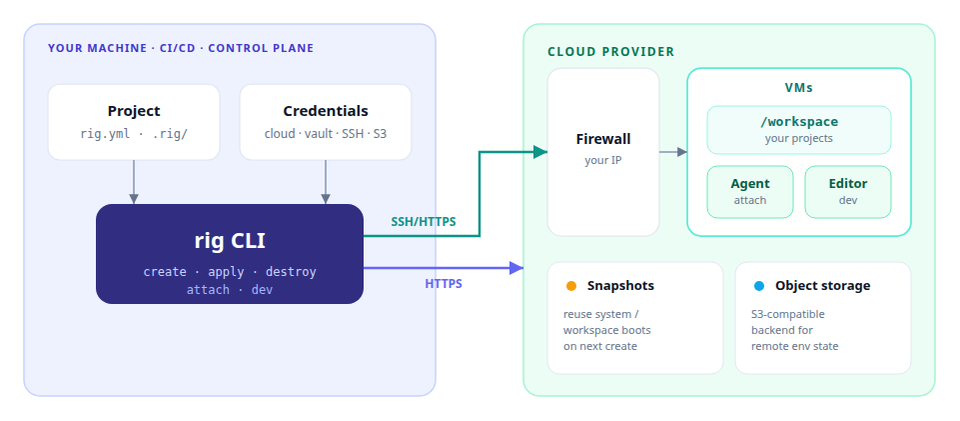

[](https://github.com/mystack-cloud/rig/actions/workflows/tests.yml)
[](https://github.com/mystack-cloud/rig/actions/workflows/tests.yml)

# rig

Secure, fast, cost-efficient ephemeral remotes with full local parity—so coding agents and humans can develop and e2e-test for real.

```bash
pip install .
rig init
rig create
```

## Architecture

Run `rig` from your machine, CI/CD, or a control plane: it provisions cloud VMs you can create and dispose anytime, and you work on `/workspace` via agent TTY or editor. SSH/HTTPS reaches VMs through the firewall; HTTPS reaches the provider. The CLI stores env state in S3-compatible object storage.



## Cloud providers

| Provider | Status |
| --- | --- |
| [Hetzner Cloud](https://www.hetzner.com/cloud) | Supported (VMs, firewall, snapshots, S3-compatible object storage) |
| [AWS](https://aws.amazon.com/) | Coming next |
| [GCP](https://cloud.google.com/) | Coming next |

## Coding agents

Chosen at `rig init` (`agent.type` in `rig.yml`). `rig attach` opens an SSH TTY into the agent on `/workspace`.

| Agent | `agent.type` | Notes |
| --- | --- | --- |
| [OpenCode](https://opencode.ai) | `opencode` (default) | Free Zen models without an API key; keyed config uses the paid provider path |
| [Claude Code](https://docs.anthropic.com/en/docs/claude-code) | `claude` | Needs `coding_agent_api_key` (Anthropic) |
| [Cursor CLI](https://cursor.com/docs/cli/overview) | `cursor` | Installs `agent` on the VM; needs `coding_agent_api_key` (`CURSOR_API_KEY`) |

Agent config scaffolds under `.rig/.opencode/`, `.rig/.claude/`, or `.rig/.cursor/` (plus `AGENTS.md`). Independent of `editor` (local IDE for `rig dev`).

## IDEs

`rig dev` opens the remote `/workspace`. Default is local editor + Remote-SSH; `--browser` uses code-server on the VM.

| Mode | Clients |
| --- | --- |
| Remote-SSH (default) | VS Code (`code`), VS Code Insiders (`code-insiders`), Cursor (`cursor`), VSCodium (`codium`) |
| Browser (`--browser`) | code-server (password: vaulted `vscode_browser_password`) |

Chosen at `rig init` (`editor` in `rig.yml`), or override with `--editor`. Local Cursor/VS Code talks to the VM over SSH (no Cursor install on the VM). Browser login: `rig vars decrypt vscode_browser_password`.

## Layout

`rig init` writes commit-friendly files into the current directory (including a subdirectory of a git repo):

```text
rig.yml                 # workspace manifest (vm, agent, playbooks, repos)
.gitignore              # adds .rig/collections, roles, inventory (via init)
.rig/
  system.yml            # auto-generated; code-server + agent + gh/glab
  workspace.yml         # custom; clone repos / project setup
  finalizers.yml        # custom; release off-VM resources before destroy
  vars.yml              # Ansible vars (vaulted secrets OK)
  requirements.yml      # Galaxy collections/roles
  AGENTS.md             # agent instructions
  .opencode/ | .claude/ | .cursor/  # agent config + MCP
  inventory.yml         # generated at create/apply (gitignored)
  collections/ roles/   # Galaxy installs (gitignored)
```

`rig.yml` defaults (edit to configure):

```yaml
vm:
  type: cax11
  availability_zone: hel1
  image: ubuntu-24.04
firewall:
  mode: dynamic_add   # open | static | dynamic_replace | dynamic_add
  allowed_ips: []     # static allow-list; also merged into dynamic modes
  ports: []           # extra inbound ports, e.g. [8080, "3000-3001", {port: 53, protocol: udp}]
agent:
  type: opencode          # or claude | cursor
editor: code                  # code | code-insiders | cursor | codium
playbooks:
  system: .rig/system.yml
  workspace: .rig/workspace.yml
  finalizers: .rig/finalizers.yml
```

Firewall modes:

| Mode | Behavior |
| --- | --- |
| `open` | SSH/ICMP from anywhere (`0.0.0.0/0`) |
| `static` | Only `allowed_ips` (no client detection) |
| `dynamic_replace` | Set allow-list to current CLI public IP (+ `allowed_ips`); drops previous IPs |
| `dynamic_add` (default) | Keep existing allow-list entries; add current CLI public IP if missing |

Attach / apply / dev / destroy refresh the firewall for dynamic modes when the client IP changes, and keep `ports` in sync.

`firewall.ports` opens extra inbound listeners with the same source-IP policy as SSH (TCP by default; use `{port, protocol}` for UDP).

Remote project files live under `/workspace` (not `/root`).

## Lifecycle

```text
init  →  create  →  attach | dev | apply  →  destroy
              ↓
         snapshots (reuse on next create)
```

| Stage | What happens |
| --- | --- |
| **init** | Scaffold `rig.yml` + `.rig/`. Collect Hetzner creds (`~/.rig/config`), repo PATs, agent choice/key. Idempotent: fills missing files only. |
| **create** | Boot VM (base image, or matching snapshot). Run `system.yml` then `workspace.yml` unless skipped by snapshot. Snapshot after each. Attach agent TTY unless `--no-attach`. |
| **apply** | Re-run `workspace.yml` (or `--system`) on an existing env. |
| **attach** | SSH TTY into `opencode` / `claude` / Cursor `agent` on `/workspace`. |
| **dev** | Open VS Code/Cursor via Remote-SSH on `/workspace` (or `--browser` for code-server). |
| **destroy** | Run `finalizers.yml`, then delete VM / firewall / SSH key. |

Last env name is remembered in `/tmp/.rig/last-env` (used when `name` is omitted).

After you leave an agent TTY, rig captures the printed session / resume id (when the agent prints one) under `/tmp/.rig/sessions/<env>`. A later bare `rig attach` reopens that session (`--session` for OpenCode, `--resume` for Claude Code / Cursor). Pass `-c` / `--session` / `--resume` to override.

After you leave an agent TTY, rig captures the printed session / resume id (when the agent prints one) under `/tmp/.rig/sessions/<env>`. A later bare `rig attach` reopens that session (`--session` for OpenCode, `--resume` for Claude Code / Cursor). Pass `-c` / `--session` / `--resume` to override.

### Snapshots

| Boot source | Skips |
| --- | --- |
| `workspace-{name}-{hash}` | system + workspace |
| `rig-{version}` | system only |
| base image | nothing |

Workspace hash covers durable inputs (`rig.yml`, `workspace.yml`, `finalizers.yml`, vars, agent scaffolds, requirements). Excludes `inventory.yml`, auto-generated `system.yml`, and Galaxy installs.

Override with `--force-playbooks` / `--force-system` / `--force-workspace`. Clear with `rig cache clear` or `rig cache --system clear`.

## CLI

Global: `-v` debug · `-q` warnings/errors only · `--version`

| Command | Args | Notes |
| --- | --- | --- |
| `init` | | Interactive scaffold |
| `create` | `[--name]` `[--type]` `[--availability-zone]` `[--image]` `[--no-attach]` `[--force-playbooks\|--force-system\|--force-workspace]` | VM defaults from `rig.yml`; flags override. `--region` aliases `--availability-zone`. |
| `apply` | `[name]` `[--system]` | Default: workspace playbook |
| `attach` | `[name]` `[-c\|--continue]` `[-s\|--session ID]` `[--resume [ID]]` `[-- …agent args]` | Reopens last remembered session by default; flags override |
| `dev` | `[name]` `[--path /workspace]` `[--browser]` `[--editor code\|cursor\|…]` | Remote-SSH by default; `--editor` overrides `editor` in `rig.yml` |
| `list` | | Lists envs, or `No remote environments` |
| `destroy` | `[name …]` | Runs finalizers first; multi-name OK |
| `cache` | `[--system] clear` | Delete workspace or system snapshots |
| `vars encrypt` | `[--stdin-name VAR]` | Vault into `.rig/vars.yml` via `/tmp/.rig/.data-key` |
| `vars decrypt` | `[VAR]` | Decrypt from `.rig/vars.yml` |

## Ansible variables

Playbooks load `.rig/vars.yml` first, then runtime `rig_*` extras (`-e` JSON). Prefer `{{ rig_env_name }}` over hard-coding.

| Variable | Meaning |
| --- | --- |
| `rig_env_name` | Env / VM name (`dev-…`) |
| `rig_workspace_name` | `rig.yml` `name` |
| `rig_vm_name` | VM name (usually same as env) |
| `rig_vm_type` | Hetzner server type |
| `rig_availability_zone` | Hetzner location (`hel1`, …) |
| `rig_vm_image` | Boot image or snapshot id |
| `rig_vm_ip` | Public IPv4 |
| `rig_vm_id` | Hetzner server id |
| `rig_agent_type` | `opencode` or `claude` |
| `rig_workspace_root` | `/workspace` |
| `rig_version` | Installed `rig` package version |
| `rig_boot_source` | `base` \| `system` \| `workspace` |
| `rig_action` | `create` \| `apply` \| `destroy` |
| `rig_project_dir` | Local project path |
| `rig_ssh_key_name` / `rig_ssh_key_path` | Local key under `/tmp` |
| `rig_firewall_name` | Firewall resource name |
| `rig_repos` | `[{name, url, path}, …]` (no secrets) |
| `rig_git_providers` | e.g. `github`, `gitlab` |

Also available from `vars.yml` (defaults): `workspace_root`, `coding_agent_type`, `git.clone_repos`, vaulted PATs / `coding_agent_api_key`.

`vscode_browser_password` is auto-generated (vaulted) for code-server browser login (`rig dev --browser`). Reveal with `rig vars decrypt vscode_browser_password` (also printed when opening browser mode).

## Credentials

| Source | Purpose |
| --- | --- |
| `~/.rig/config` | Hetzner token (+ optional S3). Profile via `RIG_PROFILE` (default `default`). Env vars override. |
| `/tmp/.rig/.data-key` | Ansible vault password for `.rig/vars.yml` (tmpfs; cleared on reboot). |
| `/tmp/<env>-key` | Per-env SSH private key (needed for attach / apply / destroy finalizers). |

OpenCode without `coding_agent_api_key` uses free Zen models. With a key, config switches to the paid provider path.

## Tests

```bash
python -m pytest tests/ -m "not requires_credentials"
```

## License

MIT
